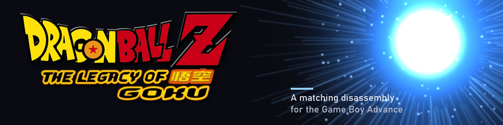

<!-- TODO demo GIF: a short capture of extract.cmd, rebuild.cmd and the gate printing GATE PASS, saved as docs/demo.gif and placed under the tagline. -->
<!-- TODO social preview: set the repository social image in Settings once the banner exists. -->
<p align="center"></p>

# Dragon Ball Z: The Legacy of Goku disassembly

**A byte-exact disassembly of Dragon Ball Z: The Legacy of Goku (GBA, USA) that rebuilds the original ROM from tracked source.**


## Contents

- [What this is](#what-this-is)
- [What this is not](#what-this-is-not)
- [Progress](#progress)
- [Building](#building)
- [Reading and changing a function](#reading-and-changing-a-function)
- [Tests](#tests)
- [Repository layout](#repository-layout)
- [Credits and license](#credits-and-license)

## What this is

The startup block is ARM assembly. ARM Developer Suite 1.2 assembles and links it back into the
retail ROM, and the gate compares the result with the retail sha256. Every start the census proves is
code is disassembled to Thumb or ARM assembly as well, and the rest of the image is carried as
slices of the retail image, so the gate's count names every byte of it.

It builds one ROM:

* Dragon Ball Z: The Legacy of Goku (USA), sha1 `a3c8c76742f11fc6a3f6e3fcca20992458cac0b5`

## What this is not

This is not a decompilation. The build compiles no C: the census's code rows are disassembled to
assembly, the data rows and the residual image stay slices, and no function has a name yet. A start
is where a static channel names the address, not a prologue this tree proves, so no function
boundary is claimed either. Naming or joining one takes evidence, never a guess.

The progress figure below measures how much of the ROM the build produces from tracked source. It
does not measure how much of the code has been turned into C.

## Progress

0.5420 % of the ROM (45,466 of 8,388,608 bytes) builds from tracked source: the startup block at
`0x080000c0` in [asm/crt0.s](asm/crt0.s) and every census code row, disassembled into `build/code/`
by [tools/code/emit_code.py](tools/code/emit_code.py). The rest is INCBIN slices of the retail
image. `python tools\gate\gate.py` prints the split, and the code and data classes it derives are
the page [docs/CODE_SPLIT.md](docs/CODE_SPLIT.md), which `tools/split/census.py --check` re-derives.

## Building

You need ARM Developer Suite 1.2, Python 3.12, Visual Studio 2022 or Build Tools with the C++
workload, and your own copy of the game saved as `baserom.gba`. [INSTALL.md](INSTALL.md) has the
details. The build compiles the jcalg1 compressor from the vendored source when it is absent, so no
compiled copy of it is distributed here.

```
extract.cmd
rebuild.cmd
python tools\gate\gate.py
```

The gate rebuilds from scratch and prints `DIGEST MATCH` and `GATE PASS` when the output equals the
retail ROM.

## Reading and changing a function

1. Find the start in [tools/code/CENSUS_EVIDENCE.csv](tools/code/CENSUS_EVIDENCE.csv). It carries one
   row per start, with the end the walk reached, the Thumb or ARM mode, the channel that found the
   address and the entry flags. [docs/CODE_SPLIT.md](docs/CODE_SPLIT.md) counts them by channel and
   by reason, and `tools/split/census.py --check` re-derives it. The startup block is the one start
   written by hand, in [asm/crt0.s](asm/crt0.s).
2. Read its file. Every code row becomes one file, `build\code\code_<address>.s`, which
   [asm/remainder.s](asm/remainder.s) includes at the address the row starts on; a branch target
   inside it carries a `loc_<address>` label. The file is generated at build time, so read it after
   `rebuild.cmd` has run.
3. Changing what a start does means changing what it is generated from: the instructions are decoded
   from the retail image by [tools/code/emit_code.py](tools/code/emit_code.py) from the bounds in the
   census, so the change that keeps is to the decoder, to the census row or to the hand transcription
   in `asm/crt0.s`.
4. Any such change has one proof: `rebuild.cmd`, then `python tools\gate\gate.py`, which must still
   print `DIGEST MATCH` and `GATE PASS`. The gate purges every object first, so a rebuild that did
   not really happen cannot pass as one.

## Tests

`check.cmd` runs the link check, the source checks and every test file, one file per process; its
test step needs the runner CI installs, `python -m pip install pytest`. The CI workflow at
[.github/workflows/check.yml](.github/workflows/check.yml) runs the same link check and source
checks, and then the whole suite one file per process. A test that needs the retail image skips while
`baserom.gba` is absent, which is what CI runs.

## Repository layout

| Path | Contents |
| --- | --- |
| `asm/` | the assembly the image is built from: the transcribed startup block, the equates, the include list and the generated remainder |
| `tools/` | the gate, the source checks, the slice writer, the census, the emitter, the recompiler input, the compressor and the tests; `tools/README.md` says what runs each one |
| `docs/` | the reader guide; `docs/README.md` says where to start |
| `build/` | the objects, the generated assembly files and the image; never tracked |
| `work/` | the rebuild log the gate writes; never tracked |

## Credits and license

The gate, the source checks, the link check, the slice writer and the build scripts start from the
[2genkidev/buusfury](https://github.com/2genkidev/buusfury) disassembly. Third-party code and
credits are listed in [NOTICE](NOTICE). Changes are listed in [CHANGELOG.md](CHANGELOG.md).

No ROM, BIOS or extracted game data is included. You need your own legally obtained copy of the
game. Not affiliated with the rights holders of the game.

MPL-2.0, see [LICENSE](LICENSE).
